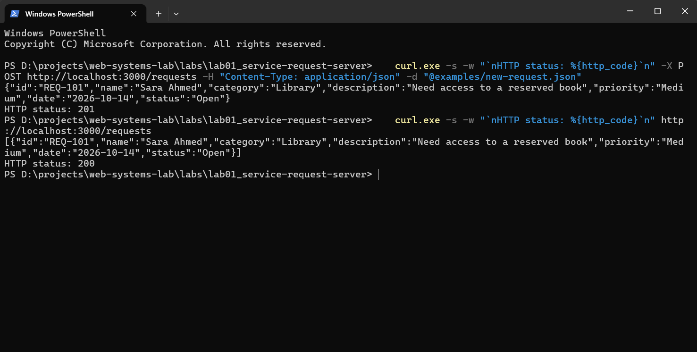

# Lab 01: Service Request Server

This lab implements a service request HTTP server with Node.js core modules only. It stores requests in a JSON file and provides list, lookup, and create operations.
Part of [web-systems-lab](../../README.md).

## Architecture

```text
Client -> HTTP Request -> Node.js HTTP Server -> URL Processing -> File System -> JSON Response
```

## Requirements coverage

| Assignment requirement              | Implemented in                                     |
| ----------------------------------- | -------------------------------------------------- |
| HTTP server                         | `src/index.js`, `src/server.js`                    |
| URL routing                         | `src/server.js`                                    |
| GET `/requests`                     | `src/server.js`, `src/store.js`                    |
| GET `/requests/:id`                 | `src/server.js`, `src/store.js`                    |
| POST `/requests`                    | `src/server.js`, `src/validate.js`, `src/store.js` |
| JSON file storage via the `fs` APIs | `src/store.js`                                     |
| JSON responses                      | `src/server.js`                                    |
| Invalid URL and invalid id handling | `src/server.js`                                    |

## Run and test

Run these commands from this directory:

```powershell
npm start
npm test
```

The server requires Node.js 22 or later. `PORT` selects the HTTP port and defaults to `3000`. `DATA_FILE` selects the JSON data file and defaults to `data/requests.json` relative to this lab.

## API reference

All responses use `application/json`.

| Method | Path            | Success                                                | Error statuses and triggers                                                                                                                                                                                                                          |
| ------ | --------------- | ------------------------------------------------------ | ---------------------------------------------------------------------------------------------------------------------------------------------------------------------------------------------------------------------------------------------------- |
| GET    | `/requests`     | `200` with all stored requests                         | `405` for an unsupported method; `Allow: GET, POST` is returned                                                                                                                                                                                      |
| POST   | `/requests`     | `201` with the created request and a `Location` header | `400` for invalid JSON or validation failure; `405` for an unsupported method with `Allow: GET, POST`; `413` when the body exceeds 100 KiB; `415` when `Content-Type` is not `application/json`; `500` for an unexpected server or file-system error |
| GET    | `/requests/:id` | `200` with the matching request                        | `400` when `id` does not match `REQ-<digits>`; `404` when the id is not stored; `405` for an unsupported method with `Allow: GET`; `500` for an unexpected server or file-system error                                                               |
| Any    | Any other path  | None                                                   | `404` when the URL is not a supported route                                                                                                                                                                                                          |

## Request fields

POST accepts a JSON object. Unknown input fields are ignored.

| Field         | Required in POST input | Server sets           | Allowed values and limits                                                                                 |
| ------------- | ---------------------- | --------------------- | --------------------------------------------------------------------------------------------------------- |
| `id`          | No                     | Yes                   | Generated as `REQ-<digits>`; client values are ignored                                                    |
| `name`        | Yes                    | No                    | String from 1 to 100 characters; surrounding whitespace is trimmed                                        |
| `category`    | Yes                    | No                    | `IT Support`, `Maintenance`, `Library`, `Transport`, `Classroom/Equipment`, `Lost & Found`, or `Facility` |
| `description` | Yes                    | No                    | String from 1 to 1000 characters; surrounding whitespace is trimmed                                       |
| `priority`    | Yes                    | No                    | `Low`, `Medium`, or `High`                                                                                |
| `date`        | No                     | Defaulted when absent | Valid calendar date in `YYYY-MM-DD`; defaults to the current local date                                   |
| `status`      | No                     | Yes                   | Always set to `Open`; client values are ignored                                                           |

## Examples

Run these commands from `labs/lab01_service-request-server/` while the server is running on port 3000.

List requests:

```powershell
curl.exe -s -w "`nHTTP status: %{http_code}`n" http://localhost:3000/requests
```

Response:

```text
[]
HTTP status: 200
```

Create a request:

```powershell
curl.exe -s -w "`nHTTP status: %{http_code}`n" -X POST http://localhost:3000/requests -H "Content-Type: application/json" -d "@examples/new-request.json"
```

Response:

```text
{"id":"REQ-101","name":"Sara Ahmed","category":"Library","description":"Need access to a reserved book","priority":"Medium","date":"2026-10-14","status":"Open"}
HTTP status: 201
```

Get one request:

```powershell
curl.exe -s -w "`nHTTP status: %{http_code}`n" http://localhost:3000/requests/REQ-101
```

Response:

```text
{"id":"REQ-101","name":"Sara Ahmed","category":"Library","description":"Need access to a reserved book","priority":"Medium","date":"2026-10-14","status":"Open"}
HTTP status: 200
```

Create a request with validation errors:

```powershell
curl.exe -s -w "`nHTTP status: %{http_code}`n" -X POST http://localhost:3000/requests -H "Content-Type: application/json" -d "@examples/invalid-request.json"
```

Response:

```text
{"error":"Validation failed","details":["name must be between 1 and 100 characters","category must be one of: IT Support, Maintenance, Library, Transport, Classroom/Equipment, Lost & Found, Facility","description must be between 1 and 1000 characters","priority must be one of: Low, Medium, High"]}
HTTP status: 400
```

Request an invalid id:

```powershell
curl.exe -s -w "`nHTTP status: %{http_code}`n" http://localhost:3000/requests/abc
```

Response:

```text
{"error":"Invalid request id: abc"}
HTTP status: 400
```

Request an unknown route:

```powershell
curl.exe -s -w "`nHTTP status: %{http_code}`n" http://localhost:3000/nope
```

Response:

```text
{"error":"Not found"}
HTTP status: 404
```

## Design notes

- Writes use a temporary file followed by `rename` to replace the data file atomically.
- A serialized write queue reads and writes each request in order, preventing lost updates during concurrent POST requests.
- Request bodies are limited to 100 KiB; larger bodies return `413` and close the connection.
- The data directory is gitignored, so runtime request data is not committed.
- A missing data file is treated as an empty request list.

## Demo


